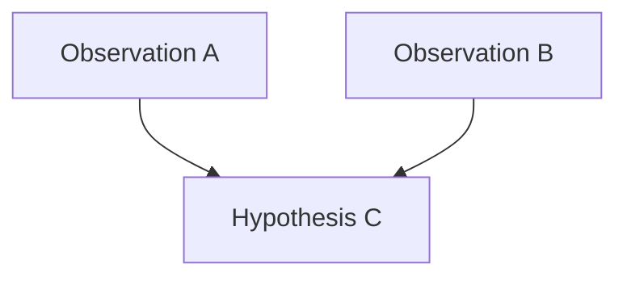

# Images and Mermaid inside formatted components

`janus`, `janus-log` and `annotation` bodies use the same safe Markdown, local
image resolver and Mermaid renderer as ordinary story content. Component titles,
timestamps, legacy JANUS inheritance, beat structure and metadata migration keep
[their existing rules](COMPONENT-IDENTITY.md). No migration is needed for media.
`yaml` remains wholly literal: neither image syntax nor Mermaid-looking code
loads a resource or runs a diagram.

Open the synthetic [mixed-media project](samples/formatted-media-project/)
as a VS Code folder, then select **Media inside components** in the outline.
It contains original synthetic PNG/JPEG/WebP assets and no manuscript extracts.
Beat one has all three formats, multiple diagrams, images in a list/table/paragraph,
repeated references and separate component metadata. Subsequent beats exercise
recoverable failures, legacy titles and literal YAML. Missing-image diagnostics
in this sample are intentional.

## Copyable syntax

Use a longer outer fence than any nested fence. Four backticks around typeout
allow the ordinary three-backtick Mermaid syntax:

`````markdown
````typeout
@format janus-log
@identity component
@title RELATIONSHIP MODEL
@timestamp 2030-10-20 02:19
@sound none

Generated from retained observations.


*Caption: A retained relationship model.*

| Subject | Relation | Object |
| --- | --- | --- |
| Observation A | supports | Hypothesis B |



Further analysis follows the diagram.
````
`````

Change only `@format` to `janus` or `annotation` for the other presentations.
Optional per-diagram style frontmatter and the supported diagram families follow
[Mermaid's existing authoring rules](MERMAID.md). Other code fences stay readable
code; they never execute. The callout converter preserves nested fences, including
Mermaid style frontmatter, and chooses a sufficiently long typeout delimiter.
Its diff/Apply workflow and metadata migration retain authored order, component
identity, beat titles and beat boundaries.

## Image and export rules

Paths are relative to the containing scene, even inside tables or lists. Use
ordinary Markdown; for a filename with spaces, use
`` or percent-encoded spaces.
PNG, JPEG and WebP retain the existing file-signature checks. Remote/data URLs,
unsupported formats, forbidden traversal and symlink escapes remain forbidden.
There is no new embed or remote-content permission. Alt text remains the image's
alternative; the existing standalone `*Caption: plain text*` convention is supported.
Captions remain plain text, and ordinary URL links remain inert.

Discovery includes the formatted body. Extension preview uses the ordinary
webview URI adapter; export copies validated assets under content hashes and
rewrites reader URLs using the existing media map. Repeated references share one
exported copy. The exported directory works without the original workspace.
Missing/unreadable/unsupported files produce a readable placeholder and a
scene/line diagnostic. Unsafe export paths remain export errors rather than
being silently ignored. Images fit their component, retain their aspect ratio,
and table-cell images are bounded; wide tables and diagrams scroll locally.

Standalone figures fill the available component-body width, keep their natural
aspect ratio and have no height cap. A portrait document can span several screens:
normal vertical reading scroll keeps graph labels legible instead of shrinking
the whole document to a thumbnail or viewport height. Its block reveal wrapper
fills that same width during hidden preparation and visible playback. Captions
remain below the figure. Genuine inline images and table-cell images retain the
compact `12rem` height maximum; table-cell width also stays bounded to `12rem`.
Mermaid retains its readable intrinsic SVG width and font size inside a focusable
horizontal scroll region, without scaling all its text down to fit the page.

The [sizing workshop](samples/formatted-sizing-project/) tests a substantial
1000×1800 portrait relationship graph and a wide eight-stage Mermaid diagram in
all three formats. Use `python test/formatted-sizing-web.py /tmp/new-sizing-reader
/tmp/sizing-evidence` after exporting that project; the installed-extension scope
is `STORY_TELLER_HOST_SCOPE=formatted-sizing` with the normal `test:host` command.
Both tests assert actual image/wrapper/SVG dimensions in hidden preparation and
visible playback at desktop and narrow widths, not just successful asset loads.

## Reveal and preparation

JANUS keeps its paragraph, explicit statement, list-item and whole-table-row
reveal. Standalone images and diagrams are complete units in that order. An
image embedded in a JANUS paragraph, list item or table row enters with that
whole containing unit; cells are never separate JANUS steps.

Annotation keeps character reveal around media. Its image/diagram is one atomic
step at the authored position, including an inline image in a paragraph, cell or
list item. No image URL, alt-text characters or diagram source is typed as the
normal visual presentation. The containing semantic structure remains intact.
The full annotation text reserves its layout while typing, as before.

A media unit gets at least the existing prose minimum of one second for viewing,
scaled by the reader's playback speed. JANUS units with longer visible text keep
the longer reading time; Mermaid code length and image alt text do not determine
it. The author text-speed setting does not shorten the media minimum. Pauses,
play/pause/resume, immediate reveal, replay, Previous/Next, restart and autoplay
still use the one reader/player clock. Reduced motion and immediate reveal skip
reveal intervals after resources are prepared. Authored pauses remain authored.

Each current beat prefetches media in a measurable offscreen, visually hidden
container only when the reader pane is visible. The complete table is measured
after image/diagram preparation, before rows are clipped. There is no full-height
blank region for unrevealed rows. Ready DOM is retained during reveal, avoiding
repeated Mermaid renders, duplicate SVG IDs and scroll resets. Follow story
suspends for manual table/diagram inspection through its existing mechanism.

Image loading is bounded to five seconds and diagram preparation to ten seconds
per job (including queue time). Errors resolve to fallbacks and do not hold beat
completion indefinitely. Revision, beat and replay cancellation invalidate stale
work; hiding the reader pauses it and cancels pending layout preparation. A
hidden reader waits for a measurable visible pane before starting layout.
Mermaid remains serial to isolate per-diagram theme/configuration. Its upstream
main-thread synchronous work cannot be preempted by a JavaScript timeout; queued
or asynchronously late results are bounded/ignored, not a worker-based CPU limit.
A theme change can legitimately prepare a new SVG, retaining local scroll offsets.

Media-bearing components have one canonical semantic body rather than duplicated
visual/accessibility media trees. Future complete units are visually clipped,
not announced row-by-row; the passage remains available for continuous assistive
reading. Future controls are removed from tab order and disabled until visible.
Annotation has a static accessible text span and an aria-hidden typing span per
text segment; images and diagrams occur once. Existing Mermaid accessible titles,
image alternatives, supporting-note controls and visible keyboard focus remain.
Human screen-reader and Apple-device acceptance still require direct testing.

## Reproducing checks

Run `npm test`, `npm run check` and `npm run package` from this tool directory.
The synthetic parser/converter/player and resource/export tests are in
`test/formatted-media*.test.cjs`. For an HTTP test, export to a **new isolated**
directory with `node src/web-export.cjs samples/formatted-media-project /tmp/new-reader`,
then run `python test/formatted-media-web.py /tmp/new-reader /tmp/media-evidence`
in an environment with Python Playwright and `/usr/bin/google-chrome`.
Use `STORY_TELLER_HOST_SCOPE=formatted-media npm run test:host` for actual VS Code;
add `STORY_TELLER_VSIX=/absolute/path/story-teller-0.17.1.vsix` for the installed
package. Tests use disposable synthetic projects, not actual adaptations.
See [RESULTS.md](RESULTS.md) and retained evidence for executed platforms and limits.
