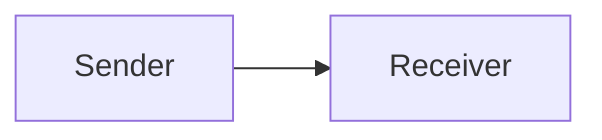
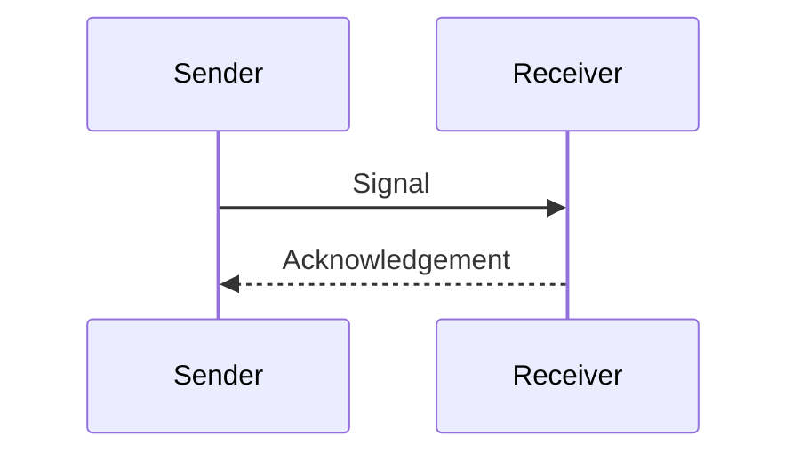

# Authored Mermaid diagrams (issue #28)

Use a standard fenced `mermaid` block. Insert… → Mermaid diagram supplies this
neutral starting point:

````markdown

````

For a sequence diagram:

````markdown

````

Diagrams are authored content, revealed whole at their position in a beat.
Top-level diagrams are separate static components; `@delay` and `@pause` work
as for prose. Play/Pause controls the sequence, not individual nodes. Initial
untimed diagrams appear while ready. Previous and Reveal beat display them;
Replay/Restart reuse the existing playback policy. Rendering does not block
navigation. Detached destinations are ignored and measurement DOM is removed.
Visible diagrams retain their DOM during chat/timing updates. Rendering completion
uses the existing scroll follower; user suspension of following remains respected.

The bundled renderer is shared by VS Code, web export, full supporting panels
and front/back matter. Hover excerpts retain readable fallback rather than
rendering a second miniature diagram. Ordinary code fences remain literal code.

Provide `accTitle` and `accDescr` (including Mermaid's multiline description
syntax where needed). The authored description is also shown as readable text.
The source is always available through a native details control, initially open
when no description is supplied or rendering fails. Source alone may be a poor
alternative for a complex diagram: authors must review its accessibility.

Wide diagrams keep their intrinsic size in a focusable horizontal scroll region;
Tab to it and use arrow keys, or swipe/scroll. Text is not shrunk to fit a phone.
Colours follow the reader's inherited light/dark presentation and refresh when the reader theme changes.
Diagrams are static under all motion settings. No node animation is implemented.

Security deliberately limits Mermaid: strict mode, HTML labels disabled, no
configuration/frontmatter directives, authored styling, HTML, click/link or
resource syntax. Such source falls back visibly. SVG is sanitised and external
references are removed; no binding callbacks are installed. Existing reader CSP
remains unchanged. There is no CDN, external renderer or icon-pack registration.
Limits: 30,000 source characters and 300 edges. Exotic diagram types and very
large layouts are not comprehensively tested; rendering runs on the browser's
main thread and has no worker timeout. Mermaid syntax errors identify the fence's
source line and retain Mermaid's diagram-local parser location/message.

The synthetic `samples/diagram-project` is independent of Trilogy manuscripts and
published books. Its note is safe at first access: it adds only the signal already
introduced, with no onward links. This is an editorial check, not an automatic
spoiler filter.

Run `npm test`, `npm run check`, `npm run package`,
`STORY_TELLER_HOST_SCOPE=mermaid npm run test:host`, and export the sample with
`node src/web-export.cjs samples/diagram-project /new/output/path`.
Run `python test/mermaid-web.py /new/output/path` with Playwright installed.
Browser viewport checks do not establish actual iPad/iPhone/Safari or screen-reader
coverage. The runtime bundles grow by roughly 12 MB uncompressed each; both
contain Mermaid locally, and third-party licence notices accompany the export.
