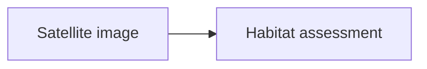
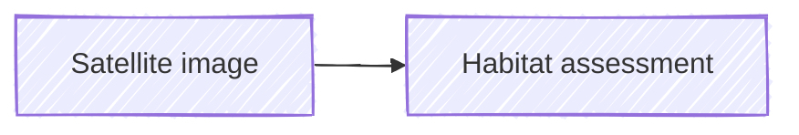

# Authored Mermaid diagrams (issue #28)

Use standard fenced `mermaid` blocks. Insert… → Mermaid diagram supplies a
neutral example. Keep `accTitle` and `accDescr` for assistive technology; the
reader does not display them as additional prose. Add a visible caption only
when wanted:

````markdown


*Caption: The assessment route.*
````

Captions use a separate paragraph in exactly this plain-text emphasis form.
They belong to the diagram in beats, supporting panels and front/back matter.
They are not derived from accessibility descriptions or Mermaid metadata titles.
Ordinary code fences retain their existing behaviour.

## Safe authored presentation

The pinned Mermaid **12.2.0** supports `look: handDrawn` and `handDrawnSeed` in its
configuration types. Use Mermaid's standard YAML frontmatter inside the fence:

````markdown


*Caption: The same route, drawn by hand.*
````

The closed allowlist is:

| Setting | Allowed values |
| --- | --- |
| `look`, `flowchart.look` | `classic`, `handDrawn` |
| `handDrawnSeed` | integer 0–2147483647; default 1 for repeatable rendering |
| `flowchart.curve` | `basis`, `bumpX`, `bumpY`, `cardinal`, `catmullRom`, `linear`, `monotoneX`, `monotoneY`, `natural`, `step`, `stepAfter`, `stepBefore`, `rounded` |
| `flowchart.nodeSpacing`, `flowchart.rankSpacing`, `flowchart.padding` | integers 8–200 |
| `sequence.actorMargin`, `sequence.messageMargin` | integers 8–200 |
| `sequence.mirrorActors` | boolean |

Unknown keys and invalid values fail the diagram rather than being silently
ignored. These are presentation options, not a promise that every Mermaid diagram
type supports every look. Flowchart hand-drawn rendering is exercised in both
readers. Settings are parsed and stripped before Mermaid sees the body, then
applied to a fresh configuration inside the serial rendering queue. Pinned
Mermaid's `initialize` resets site configuration from its defaults; configuration
does not leak to a following diagram. Diagrams without settings use `classic`.
Reader light/dark colours and inherited fonts remain reader-owned.

Standard plain-text `title` frontmatter is also supported (at most 300 characters)
as Mermaid's own diagram title. It is distinct from a Story Teller caption.
Legacy leading `%%{init: {"look":"handDrawn"}}%%` (or `initialize`) is accepted
with **JSON** content and the same allowlist. Mermaid deprecates this form in
favour of frontmatter. Multiple/embedded directives are rejected.

References: [Mermaid configuration](https://mermaid.js.org/config/configuration),
[configuration schema](https://mermaid.js.org/config/schema-docs/config).
The installed `node_modules/mermaid/dist/config.type.d.ts` and implementation
were also inspected; online documentation may describe a newer release.

## Reader behaviour and diagnostics

Diagrams reveal whole at their authored position. Top-level diagrams are separate
static components: `@delay` and `@pause` work as for prose. Play/Pause controls the
sequence, not nodes. Initial untimed diagrams appear while ready; Previous and
Reveal beat display them, and Replay/Restart retain existing playback policy.
Navigation remains available while rendering. Detached destinations are ignored,
IDs are unique, measurement DOM is removed, and visible diagram DOM survives
chat/timing updates. The existing scroll follower controls scroll behaviour.

The reader shows the diagram and any explicitly authored caption, without source
disclosures, fallback controls or routine technical status prose. SVG titles and
descriptions remain accessible to assistive technology. Authors should supply an
adequate description and review complex diagrams for accessibility.

On failure the reader says **“This diagram could not be displayed.”** It retains
any authored caption and continues the scene. The editable source remains in the
author's Markdown. Fence location, diagram-body offset, parser error and raw
source go to **Output → Story Teller diagram diagnostics** in VS Code and to a
`Story Teller authoring diagnostic` entry in browser developer tools. Supporting
note diagnostics identify the note. No raw source or parser details are displayed
in the reader, including panels and book matter. Hover excerpts omit diagrams;
open the full supporting panel to inspect them.

Wide diagrams keep their intrinsic size inside a focusable horizontal scroll
region: Tab to it and use arrow keys, or swipe/scroll. Text is not shrunk to fit
a phone. Colours/fonts refresh with reader presentation changes. Diagrams remain
static with all motion settings; no node animation is implemented.

## Boundaries and validation

Security remains fixed: strict mode, HTML labels disabled, no executable click
or link statements, resource nodes, HTML or raw CSS statements. Ordinary words
such as image/style/click in labels, messages and accessibility descriptions are
text. CSS/resource expressions and Markdown image syntax are rejected. SVG is
sanitised, hyperlinks/images/foreign objects and external references are removed,
and binding callbacks are never installed. Existing CSP is unchanged; runtime
and licences are bundled, with no CDN, rendering service or icon packs.

Limits: 30,000 source characters and 300 edges. Exotic diagrams are not
comprehensively tested, and browser-main-thread layout has no worker timeout.
Runtime bundles are about 13 MB each uncompressed. These viewport checks do not
establish actual iPad/iPhone/Safari or human screen-reader coverage.

`samples/diagram-project` contains neutral default/hand-drawn and failure examples,
independent of manuscripts and published books. Its opening note was checked at
first access, including full content and onward links (none): it describes only
the introduced signal and neutral renderer examples, without future plot content.
This is an editorial check, not an automatic spoiler filter.

Run `npm test`, `npm run check`, `npm run package`, and
`STORY_TELLER_HOST_SCOPE=mermaid npm run test:host`. Set `STORY_TELLER_VSIX` to the
absolute VSIX path for the installed-package run. Export the sample with
`node src/web-export.cjs samples/diagram-project /new/output/path`, then run
`python test/mermaid-web.py /new/output/path` with Playwright installed. An optional
second argument runs the same browser suite against an immutable preview URL.
