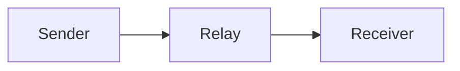
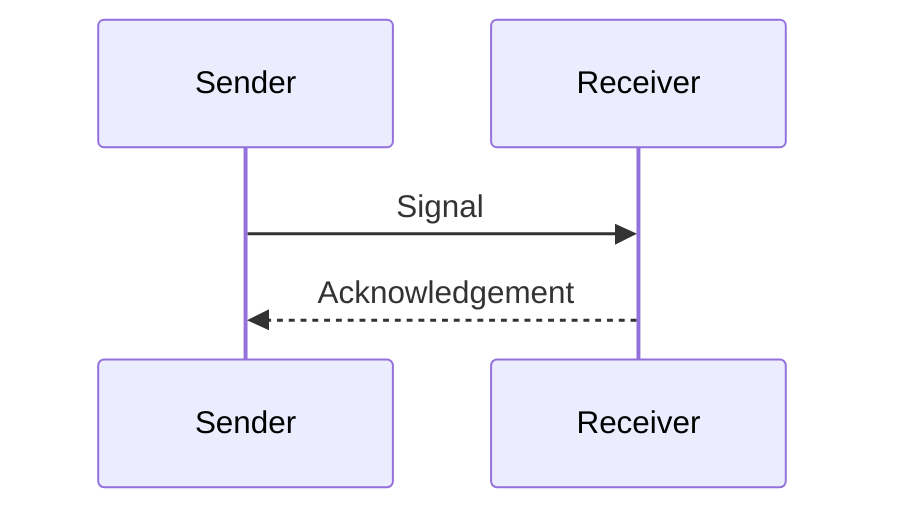

A neutral example. [[Signal note|About the signal]]



@pause 800ms



```chat
@delay 0ms
Sender: Received.
```

After the diagrams.

---

```mermaid
flowchart LR
 broken [
```

The scene continues after malformed source.

```javascript
const value = 1;
```

---


