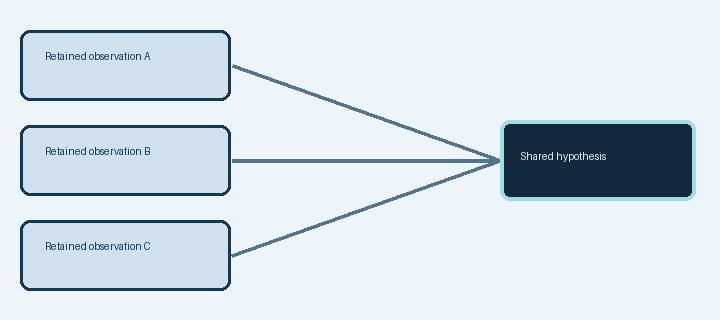
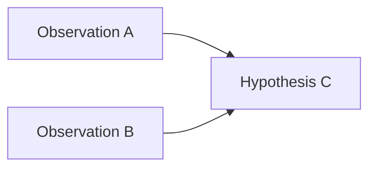
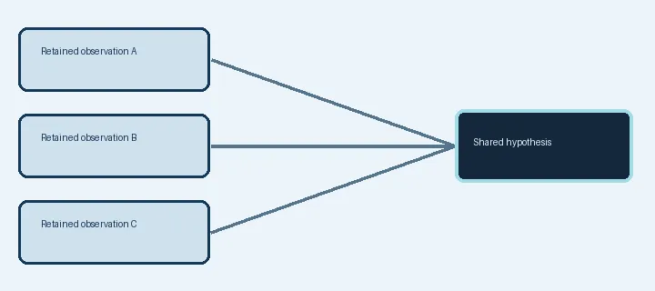
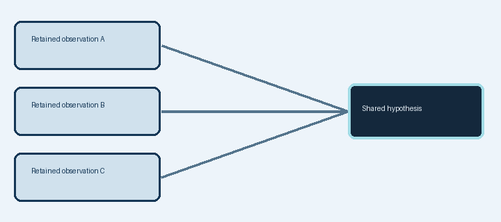
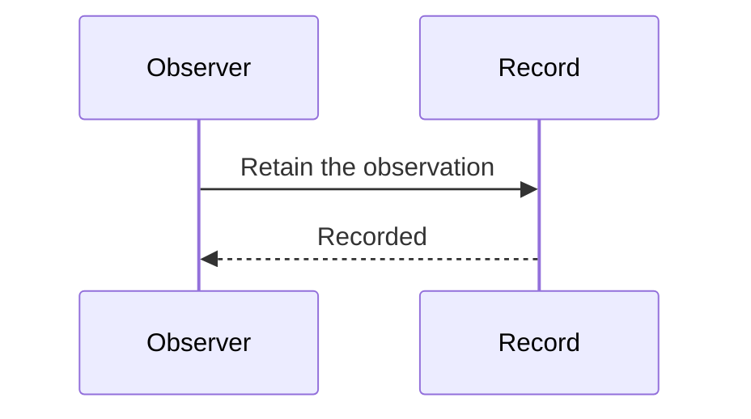
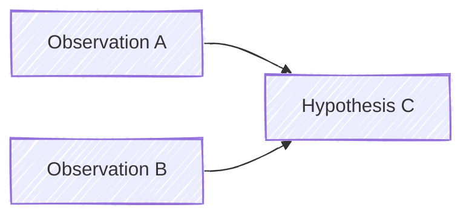
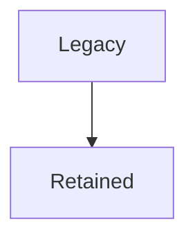
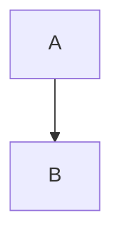

<!-- beat: Multiple formatted components share this beat -->

Synthetic prose, assets and diagrams.

````typeout
@format janus
@identity component
@title janus — Relationship model
@timestamp 2030-10-20 02:19
@sound none
@speed 120

Opening **formatted prose** before the first image.


*Caption: A synthetic retained relationship model.*

| Subject | Relation | Evidence |
| :--- | :---: | :--- |
| Observation A | supports |  |
| Observation B | qualifies | +0.94 |



*Caption: The retained model, as authored.*

Text between diagrams and another image.

- An image within an item: 
- A second item with **emphasis**.

An inline image  appears atomically while its surrounding prose retains its format.



Concluding prose after the second diagram. [[Media note|Read the media note]].
````

````typeout
@format janus-log
@identity component
@title janus-log — Relationship model
@timestamp 2030-10-20 02:19
@sound none
@speed 120

Opening **formatted prose** before the first image.


*Caption: A synthetic retained relationship model.*

| Subject | Relation | Evidence |
| :--- | :---: | :--- |
| Observation A | supports |  |
| Observation B | qualifies | +0.94 |



*Caption: The retained model, as authored.*

Text between diagrams and another image.

- An image within an item: 
- A second item with **emphasis**.

An inline image  appears atomically while its surrounding prose retains its format.


Concluding prose after the second diagram. [[Media note|Read the media note]].
````

````typeout
@format annotation
@identity component
@title annotation — Relationship model
@timestamp 2030-10-20 02:19
@sound none
@speed 120

Opening **formatted prose** before the first image.


*Caption: A synthetic retained relationship model.*

| Subject | Relation | Evidence |
| :--- | :---: | :--- |
| Observation A | supports |  |
| Observation B | qualifies | +0.94 |


*Caption: The retained model, as authored.*

Text between diagrams and another image.

- An image within an item: 
- A second item with **emphasis**.

An inline image  appears atomically while its surrounding prose retains its format.


Concluding prose after the second diagram. [[Media note|Read the media note]].
````

---
<!-- beat: Recoverable media failures -->

````typeout
@format janus-log
@identity component
@title Failures remain readable
@sound none
@speed 120


```mermaid
flowchart TD
  A[Unclosed
```

Further analysis continues after the error.
````

---
<!-- beat: Legacy media heading -->

````typeout
@format janus
@sound none
@speed 120



````

---

````typeout
@format yaml
@identity component
@title Literal media-like data
@sound none
@speed 120



````

---

End of the synthetic media review.
