```mermaid
flowchart LR
    accTitle: Wide relationship diagram
    accDescr: A synthetic sequence of retained observations, models and review.
    N0["Retained observation A"] --> N1
    N1["Recorded evidence B"] --> N2
    N2["Compared pattern C"] --> N3
    N3["Possible relationship D"] --> N4
    N4["Alternative explanation E"] --> N5
    N5["Bounded hypothesis F"] --> N6
    N6["Review outcome G"] --> N7
    N7["Further observation H"]
```

<!-- beat: Sizing workshop — three components, one beat -->

````typeout
@format janus
@identity component
@title janus — Portrait and wide relationship models
@timestamp 2030-10-20 02:19
@sound none
@speed 120

A full document image follows this opening paragraph.


*Caption: Twelve synthetic observations and review stages; read from top to bottom.*

An inline thumbnail  stays compact within its paragraph.

| Record | Preview | Change |
| --- | --- | ---: |
| Observation A |  | +0.91 |
| Observation B | Retained | −0.02 |



*Caption: Inspect this wide diagram horizontally at its readable intrinsic size.*

Concluding prose remains after the media.
````

````typeout
@format janus-log
@identity component
@title janus-log — Portrait and wide relationship models
@timestamp 2030-10-20 02:19
@sound none
@speed 120

A full document image follows this opening paragraph.


*Caption: Twelve synthetic observations and review stages; read from top to bottom.*

An inline thumbnail  stays compact within its paragraph.

| Record | Preview | Change |
| --- | --- | ---: |
| Observation A |  | +0.91 |
| Observation B | Retained | −0.02 |


*Caption: Inspect this wide diagram horizontally at its readable intrinsic size.*

Concluding prose remains after the media.
````

````typeout
@format annotation
@identity component
@title annotation — Portrait and wide relationship models
@timestamp 2030-10-20 02:19
@sound none
@speed 120

A full document image follows this opening paragraph.


*Caption: Twelve synthetic observations and review stages; read from top to bottom.*

An inline thumbnail  stays compact within its paragraph.

| Record | Preview | Change |
| --- | --- | ---: |
| Observation A |  | +0.91 |
| Observation B | Retained | −0.02 |


*Caption: Inspect this wide diagram horizontally at its readable intrinsic size.*

Concluding prose remains after the media.
````

---

End of the sizing workshop.
